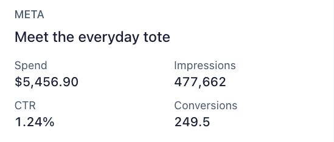
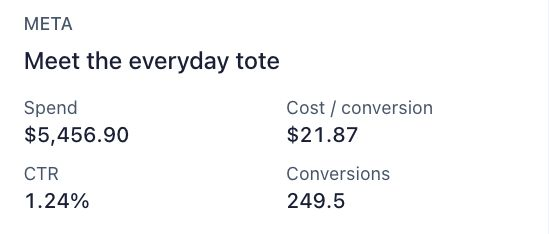
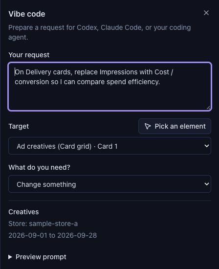
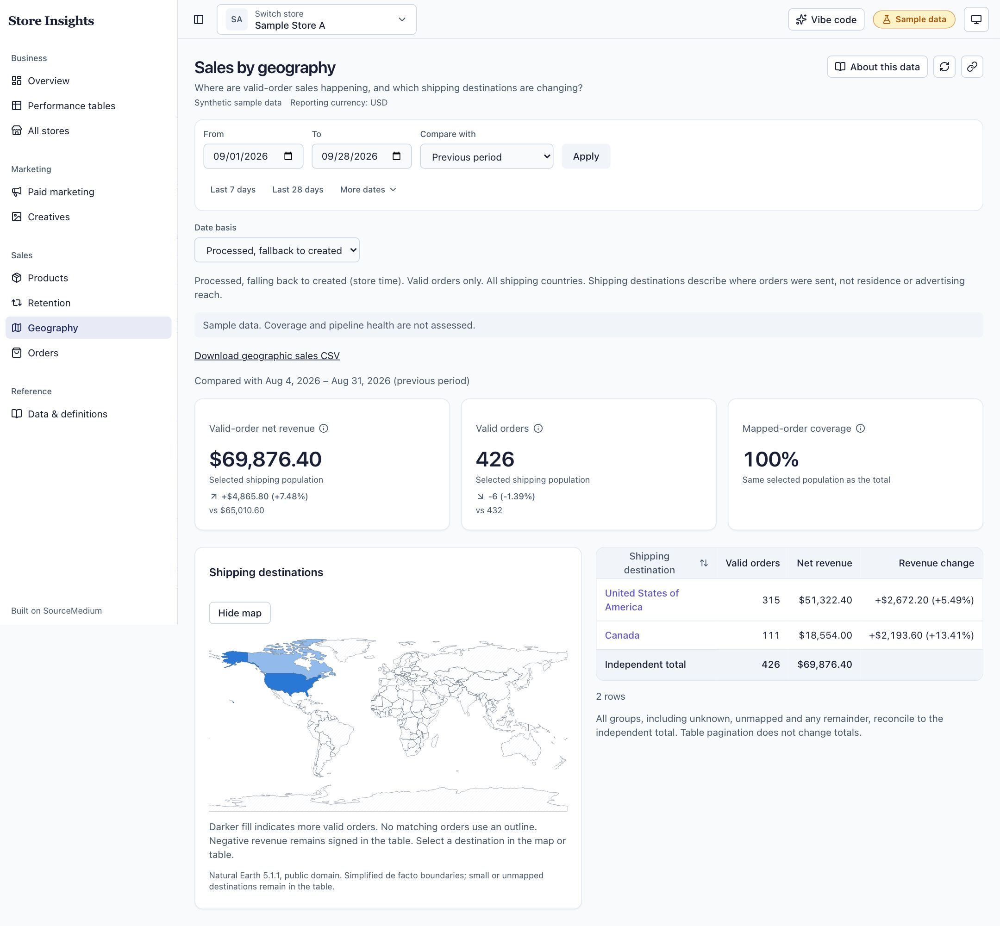
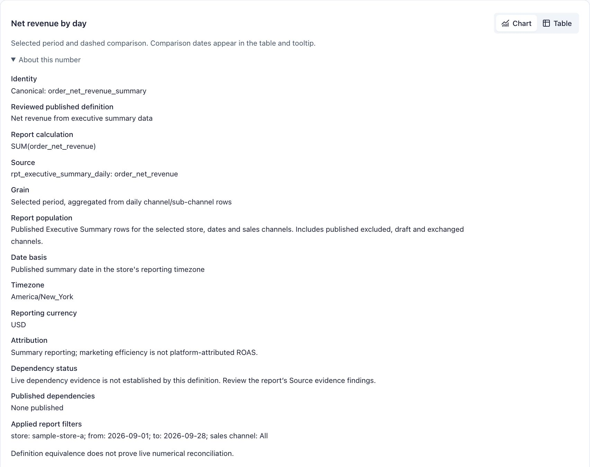
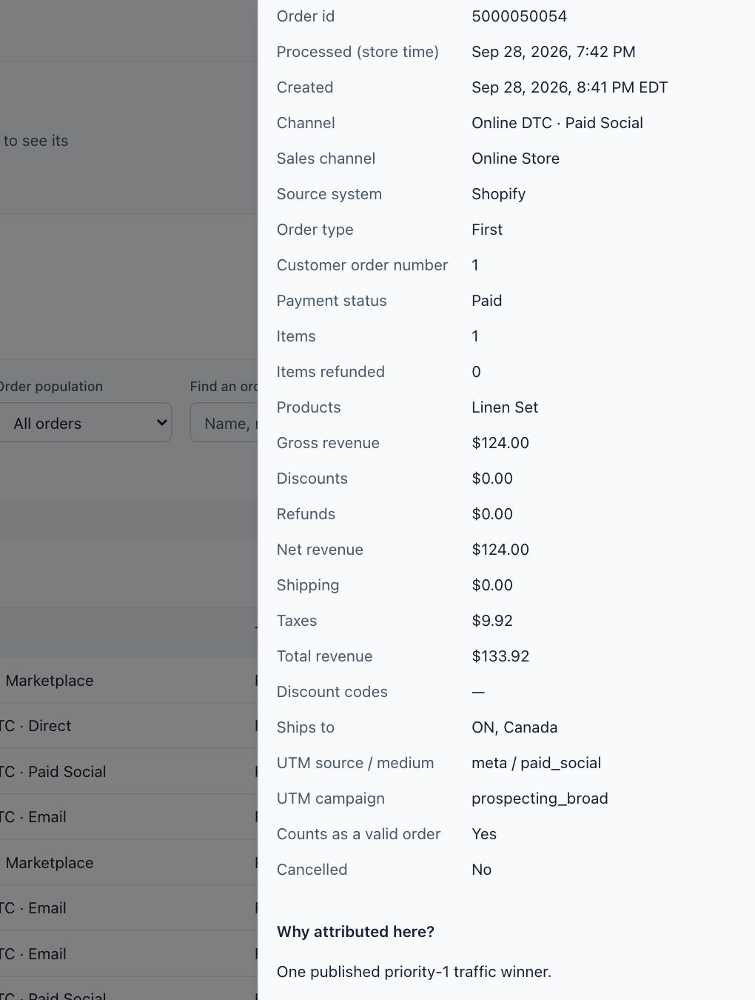
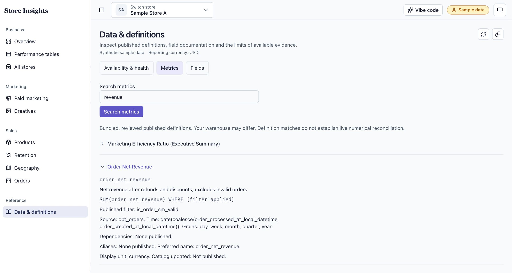
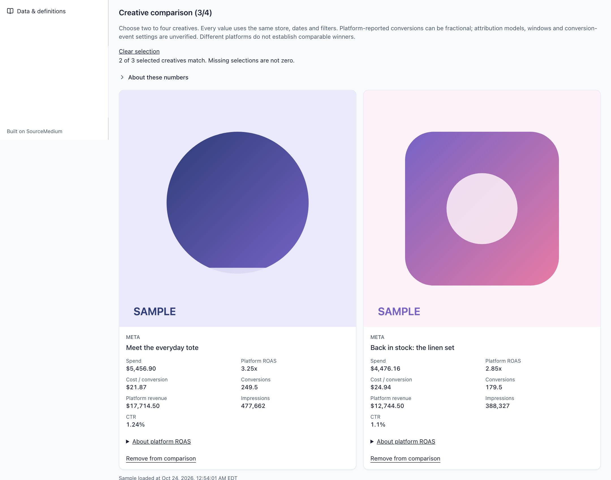
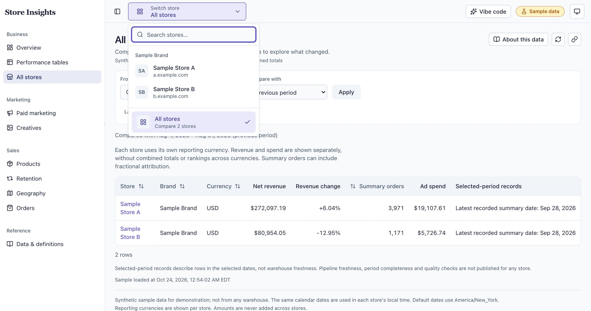

# SourceMedium App Starter

## Start with a working dashboard. Make it yours.

Ten commerce reports for your SourceMedium warehouse, ready to run, with every
number linked to its published definition, its supporting records, and what the
data can and cannot tell you. Use Codex or Claude Code to change a metric,
rework a view, or build your next report. The app and its source code are yours.

**[Run it locally](#run-it-locally)** ·
[See the reports](#ten-reports-to-start-from) ·
[Open the demo](https://sm-app-starter-demo.source-medium.workers.dev)

<picture>
  <source media="(prefers-color-scheme: dark)" srcset="docs/images/overview-dark.jpg">
  <source media="(prefers-color-scheme: light)" srcset="docs/images/overview-light.jpg">
  
</picture>

_Every screenshot uses synthetic sample data. The hosted demo reads SourceMedium's
demo warehouse. No sign-in required._

## What you get

- **Reports that lead with the answer.** Four primary metrics, a one-sentence
  readout of what moved, one large trend you switch without a new query, and
  the biggest changes by sales channel, all on one screen.
- **Sales by geography.** Valid-order revenue by shipping country and U.S.
  state on bundled, public-domain maps. No tiles, no map API keys, no
  geocoding. Every map group reconciles to an independently queried total.
- **Every number explains itself.** "About this number" on cards, charts, and
  table columns shows the published SourceMedium definition, the exact
  calculation, population, date basis, currency, and attribution behind it.
- **Attribution you can inspect.** Open any order and ask "Why attributed
  here?" to see the published winning source, its rank, and the supporting
  evidence, without raw click IDs or survey text.
- **Honest data status.** A compact strip under the filters says what the
  warehouse actually published about freshness, completeness, and quality,
  and never infers "all current" from a recent record date.
- **Side-by-side creatives.** Compare two to four creatives at identical
  scope, with minimum-spend and minimum-conversion thresholds applied after
  aggregation.
- **Data & definitions.** A searchable catalog of published metric definitions,
  field documentation, and source availability, served from the same adapter
  the reports use.
- **Exports with context.** CSV downloads keep raw values. A JSON export adds
  the filters, timezone, currency verification, metric identities, and
  limitations from the same request.

### A report should answer your question

Say you want to compare creative efficiency. Open **Vibe code**, pick a card,
and describe the change:

> On Delivery cards, replace Impressions with Cost / conversion so I can compare spend efficiency.

**Before: impressions. After: cost per conversion.**

<p>
  
  
</p>

Copy the prepared prompt into your coding agent. It includes the selected element,
page, and applied filters. Your agent edits the repo; you review the result in a
preview before publishing.

_Real captures of a local customization using sample data. The starter keeps the
default card; this example shows what you can change._

<details>
<summary><strong>See the prompt and the code change</strong></summary>



The metric already exists in the Performance view. This customization reuses it
in Delivery cards. In [`src/features/creatives/page.tsx`](src/features/creatives/page.tsx),
replace the Impressions entry in the Delivery metrics:

```diff
- { label: "Impressions", display: formatCount(creative.impressions) },
+ { label: "Cost / conversion", display: formatMoney(creative.cpo, currency) },
```

The existing calculation uses period spend / platform-reported conversions and
shows an empty value when there are no conversions. No query or schema change
is needed.

The Vibe code panel prepares context for an agent working in your repo. It does
not run an agent inside the dashboard. See [more things to ask](docs/prompts.md).

</details>

## Run it locally

Use Node.js 24 (22.22.1 or newer works) and pnpm 10.34.5.

```sh
git clone https://github.com/source-medium/sm-app-template.git my-data-app
cd my-data-app
pnpm install --frozen-lockfile
pnpm dev
```

Open **http://127.0.0.1:3000**. Sample data works immediately, with no credentials,
database setup, or AI API key. Or give your agent the [setup prompt](docs/cloud.md#your-first-message-in-either-agent)
and let it guide you through connecting your warehouse and hosting the app.

## Ten reports to start from

Store selection travels between reports, and report filters live in shareable
URLs. Period comparisons, CSV exports where available, chart-to-table views,
and light and dark modes are already in place.

| Report                 | Start with this question                                                             |
| ---------------------- | ------------------------------------------------------------------------------------ |
| **Overview**           | How did revenue, orders, and spend change, and which channels moved?                 |
| **Performance tables** | How do business metrics and platform totals compare by day, week or month?           |
| **All stores**         | Which stores are growing, and which need a look?                                     |
| **Paid marketing**     | Where is spend going, and what returns do platforms report?                          |
| **Creatives**          | Which ads are delivering, at what cost, and how do they compare side by side?        |
| **Products**           | Which products and variants drive sales, and which gained or declined?               |
| **Retention**          | How do customers from each cohort return over time?                                  |
| **Orders**             | What happened with a particular order, and why was it attributed where it was?       |
| **Geography**          | Where are valid-order sales happening, and which shipping destinations are changing? |
| **Data & definitions** | What do these metrics mean, and which evidence is available?                         |

### Where sales are happening

<picture>
  <source media="(prefers-color-scheme: dark)" srcset="docs/images/geography-dark.jpg">
  <source media="(prefers-color-scheme: light)" srcset="docs/images/geography-light.jpg">
  
</picture>

Select a country to see its regions, or a U.S. state to see its orders. The
table offers the same selection by keyboard, mobile stays table-first with an
optional map, and map geometry loads only on this page. Unknown and unmapped
destinations stay visible, and mapped-order coverage is shown against the same
population as the total.

### Every number explains itself



Definitions come from your warehouse's published semantic metric catalog, with
the report's own population, filters, and date basis stated beside them. A
report-specific calculation says so. If a published definition changes, the
status strip raises a finding for maintainer review instead of silently
changing a number.

<p>
  
  
</p>

### Compare creatives side by side



Pick up to four creatives from the cards. The comparison fetches exactly those
identities at the same store, dates, and filters, keeps platform-reported
attribution labeled as such, and never declares a winner across platforms.

<details>
<summary><strong>Compare stores, then drill into one</strong></summary>

Search by store name, domain, brand, or ID. Names and available logos come from
your warehouse; missing names fall back to a domain or store ID. **All stores**
keeps each store's currency visible and avoids combining totals across currencies.



</details>

<details>
<summary><strong>Use the naming conventions you already have</strong></summary>

Filter campaign, ad set, or ad names by text such as `[retargeting]`. Combine
contains, does not contain, equals, and starts with rules, then inspect matching
names. Your text is treated literally, with no tag taxonomy to configure.

![Creative Performance cards filtered to campaign names containing “[retargeting]”, with minimum spend and minimum conversion thresholds available.](docs/images/creatives.jpg)

Filters travel with the report link. Creative metrics reflect the matching
ad delivery, including when one creative appears in several campaigns.

</details>

<details>
<summary><strong>Follow retention and lifetime value by cohort</strong></summary>

Compare cohorts at the same age, filter acquisition channels, and switch the
matrix between retention, repeat purchase, revenue, and gross profit measures.
Ages that are not yet observable are marked distinctly from months with no data.


</details>

Each view owns its queries, sample data, and presentation. Copy the closest one
or [remove the examples](docs/removing-the-example.md). Change your name, logo,
and navigation in [`app.config.ts`](app.config.ts), and your colors and fonts in
[`src/styles/tokens.css`](src/styles/tokens.css).

## Built to be trusted

- **Numbers are exact.** Decimals stay exact through aggregation and export.
  Ratios divide aggregated numerators and denominators, never averaged daily
  ratios. Missing is never shown as zero, and fractional attributed conversions
  stay fractional.
- **Populations stay distinct.** Executive Summary orders are not valid-order
  counts, revenue per summary order is not AOV, and platform ROAS is not store
  marketing efficiency. The app says which one you are looking at.
- **Scope travels, and nothing is dropped silently.** Drill-downs carry store,
  dates, population, date basis, and compatible filters, and explain any
  transition they cannot preserve.
- **Access is enforced everywhere.** Every data function, route handler, and
  export checks the viewer and the store scope. SQL is written by developers and
  parameterized; browser input never becomes an identifier.
- **Private by default.** Pages are `private, no-store`, queries run on the
  server, and nothing sensitive reaches telemetry or agent prompts.

## Put your version online

Your agent follows the [Cloudflare guide](docs/cloud.md) to connect the app and
set up automatic deployments:

1. **Connect your data.** An organization admin creates an app in your SourceMedium
   workspace's **Dashboards & Apps** page. Enter its configuration block privately.
2. **Choose who can view it.** Use a shared password for a small trusted group,
   or Cloudflare Access for individual sign-in. Your agent helps you choose.
3. **Review, then publish.** Push a task branch for a protected preview against
   your data. Approve the change, then push `main` to deploy.

The default path uses **Cloudflare Artifacts + Workers Builds**. GitHub is
optional. Workers Paid is required; see the guide for Artifacts availability and
[current costs](docs/cloud.md).

Every viewer of a deployment sees the same data. For separate store audiences,
use separate deployments with `APP_STORE_ID`. See [sign-in and store access](docs/auth.md).
If Dashboards & Apps says credentials are still being enabled, use sample data and
[contact support](SUPPORT.md). Do not use an admin credential.

## Keep building

The repo uses Next.js, React, TypeScript, shadcn/ui, Tailwind, and Recharts.
It includes [agent instructions](AGENTS.md), skills for adding pages, querying
data and deploying, and checks for auth, store scope, data contracts, and browser
accessibility (WCAG 2.2 AA with axe, keyboard, and 320px reflow coverage).
Warehouse queries run on the server.

```sh
pnpm check      # Format, lint, types, guardrails, and unit tests
pnpm test:e2e   # Production build and browser tests
```

| Guide                               | Read it when you need to…                                   |
| ----------------------------------- | ----------------------------------------------------------- |
| [Cloud setup](docs/cloud.md)        | Set up source hosting, previews, and automatic deploys      |
| [Data connection](docs/connect.md)  | Connect a warehouse or replace a configuration block        |
| [Queries and metrics](docs/data.md) | Work with schemas, SQL, money, dates, and freshness         |
| [Sign-in and access](docs/auth.md)  | Choose a viewer guard or restrict a deployment to one store |
| [Operations](docs/operations.md)    | Diagnose errors, rotate secrets, or roll back a release     |
| [Agent prompts](docs/prompts.md)    | Add a report, change a component, or check a number         |

**0.1.0 preview.** The tested hosting target is Cloudflare Workers. Fresh-account
onboarding and self-service credential issuance still need end-to-end verification.
See [release evidence and remaining checks](docs/maintainers/release-readiness.md).

[MIT license](LICENSE) · [Security](SECURITY.md) · [Support](SUPPORT.md) · [Contributing](CONTRIBUTING.md)

For a resumable local, preview and production setup, start with [the setup guide](docs/setup.md). `pnpm app:setup plan` records sign-in and live intent; `pnpm app:setup status` checks current progress. [Reconcile a reference period](docs/reconciliation.md) before treating an adapted dashboard as numerically verified.
