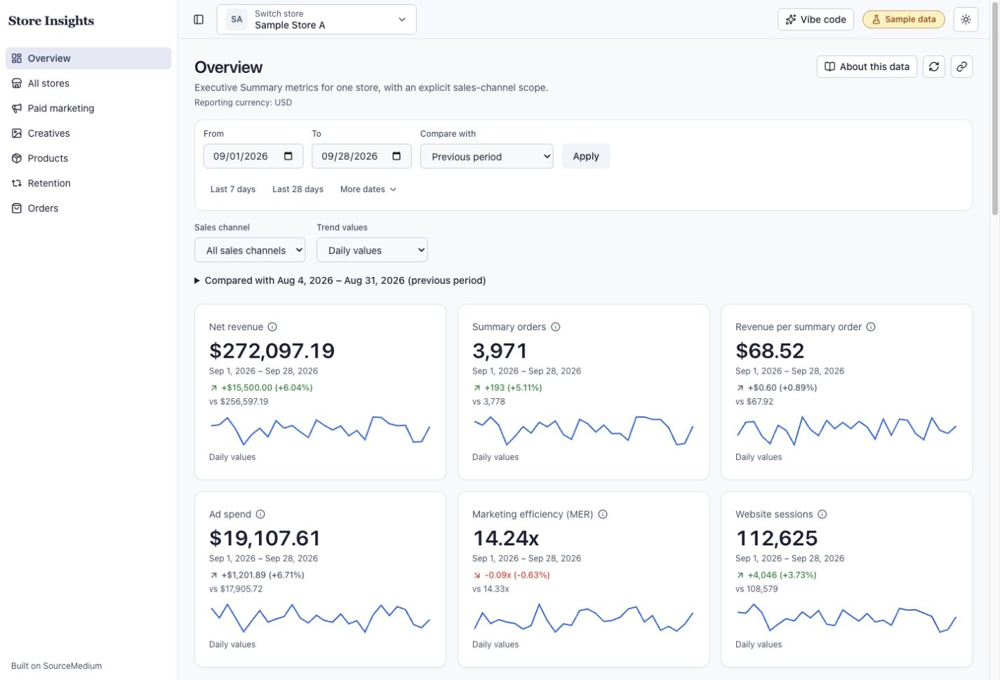
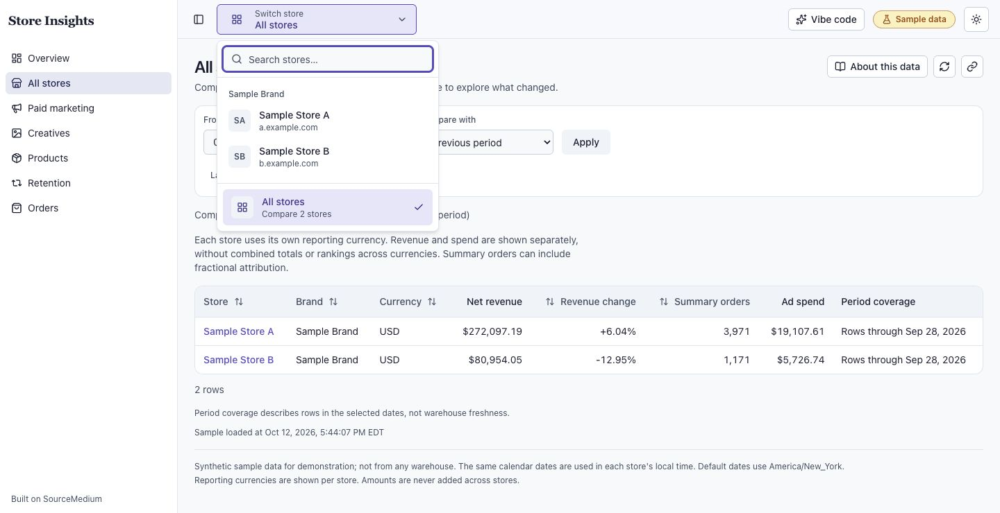
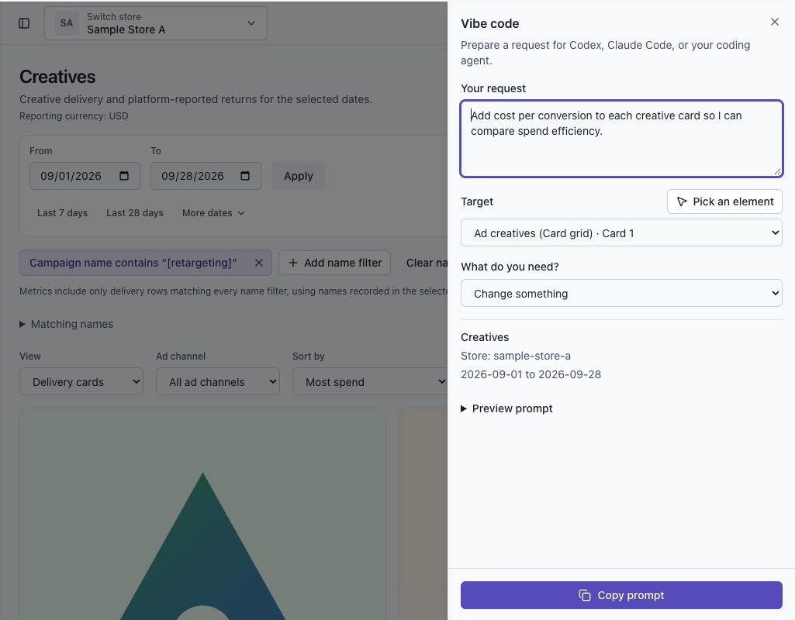
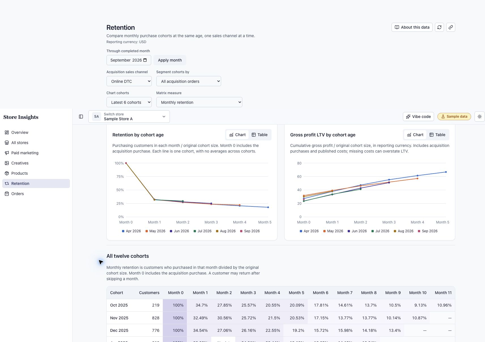

# SourceMedium App Starter

**Your warehouse, your dashboard, your code.**

A Next.js app for exploring your SourceMedium data. Start with seven reports,
then work with Codex or Claude Code to make them your own. Store switching,
comparisons, ad-name filters, light and dark modes, and viewer sign-in are built in.

**[Open the demo](https://sm-app-starter-demo.source-medium.workers.dev)** ·
[Run locally](#run-it-locally) ·
[Deploy on Cloudflare](docs/cloud.md)

<picture>
  <source media="(prefers-color-scheme: dark)" srcset="docs/images/overview-dark.png">
  <source media="(prefers-color-scheme: light)" srcset="docs/images/overview-light.png">
  
</picture>

_All screenshots use synthetic sample data. The hosted demo reads SourceMedium's
demo warehouse and requires sign-in: [request demo access](mailto:support@sourcemedium.com)._

## Run it locally

Use Node.js 22.22.1 or newer and pnpm 10.34.5. CI uses Node 24.

```sh
git clone https://github.com/source-medium/sm-app-template.git my-data-app
cd my-data-app
pnpm install --frozen-lockfile
pnpm dev
```

Open **http://127.0.0.1:3000**. Sample data works immediately, with no credentials,
database setup, or AI API key. To start with your coding agent instead, use the
[setup prompt](docs/cloud.md#your-first-message-in-either-agent).

## One store, or the whole portfolio

Search by store name, domain, brand, or ID. Names and available logos come from
your warehouse; missing names fall back to a domain or store ID. Open **All stores**
to compare performance, then select a store to investigate a change. Each store's
currency stays visible, with no combined totals across currencies.



## Put your naming conventions to work

In **Paid marketing** and **Creatives**, filter campaign, ad set, or ad names by
text you already use, such as `[retargeting]`. Combine contains, does not contain,
equals, and starts with rules. Inspect matching names before interpreting the
results. The app treats your text literally; there is no tag taxonomy to configure.

![Creative cards filtered to campaign names containing “[retargeting]”, with spend, impressions, click-through rate, and conversions.](docs/images/creatives.png)

Filters travel with the report link. Creative metrics reflect the matching
ad delivery, including when one creative appears in several campaigns.

## Point. Describe. Vibe code.

Open **Vibe code**, choose **Pick an element**, and describe what should change.
The panel prepares a prompt with the current page, applied filters, and selected
element. Copy it into Codex, Claude Code, or another agent working in your repo.
Code changes happen in your coding agent; the dashboard prepares the context.



The repo includes shared [agent instructions](AGENTS.md), skills for adding pages,
querying data and deploying, and [starter prompts](docs/prompts.md).

## Reports to make your own

| Report             | What you can explore                                       |
| ------------------ | ---------------------------------------------------------- |
| **Overview**       | Revenue, orders, ad spend, trends, and period comparisons  |
| **All stores**     | Store-by-store performance, changes, and drill-through     |
| **Paid marketing** | Channel and campaign performance, spend, and platform ROAS |
| **Creatives**      | Ad images, delivery, and platform-reported returns         |
| **Products**       | Product and variant rankings                               |
| **Retention**      | Repeat purchases and lifetime value by acquisition cohort  |
| **Orders**         | Order search, detail drawers, and pagination               |

<details>
<summary><strong>See the retention report</strong></summary>



Compare cohorts at the same age, filter acquisition channels, and switch the
matrix between retention, repeat purchase, revenue, and gross profit measures.

</details>

Each view owns its queries, sample data, and presentation. Copy the closest one
or [remove the examples](docs/removing-the-example.md). Rebrand in
[`app.config.ts`](app.config.ts) and [`src/styles/tokens.css`](src/styles/tokens.css).

## Connect once, preview each change

Your agent follows the [Cloudflare guide](docs/cloud.md) to connect the app and
set up automatic deployments:

1. **Connect your data.** An organization admin creates an app in your SourceMedium
   workspace's **Apps** page. Enter its configuration block privately.
2. **Choose who can view it.** Use a shared password for a small trusted group,
   or Cloudflare Access for individual sign-in. Your agent helps you choose.
3. **Review a preview.** Push a task branch to run the checks and build a protected
   preview against your data. Approve the change, then push `main` to deploy.

The default path uses **Cloudflare Artifacts + Workers Builds**. GitHub is
optional. Workers Paid is required; see the guide for Artifacts availability and
[current costs](docs/cloud.md).

If Apps says credentials are still being enabled, keep working with sample data
and contact [SourceMedium support](SUPPORT.md). Do not use an admin credential.

Every viewer of a deployment sees the same data. For separate store audiences,
use separate deployments with `APP_STORE_ID`. See [sign-in and store access](docs/auth.md).

## Built to keep editing

Ordinary Next.js, React, and TypeScript. shadcn/ui components, Tailwind tokens,
and Recharts are included in the repo. There is no proprietary dashboard editor.

- **Shareable views:** store, dates, and report filters live in the URL.
- **Readable data:** metric definitions, chart-to-table toggles, CSV exports where
  available, and explicit loading, empty, and error states.
- **Server-side queries:** typed SQL parameters, exact decimal handling, bounded
  results, and viewer guards.
- **Checks included:** lint, types, data contracts, store scope, Node and Worker
  tests, and browser accessibility checks.

```sh
pnpm check      # Format, lint, types, guardrails, and unit tests
pnpm test:e2e   # Production build and browser tests
```

| Guide                               | Read it when you need to…                                   |
| ----------------------------------- | ----------------------------------------------------------- |
| [Cloud setup](docs/cloud.md)        | Set up source hosting, previews, and automatic deploys      |
| [Data connection](docs/connect.md)  | Connect a warehouse or replace a configuration block        |
| [Queries and metrics](docs/data.md) | Work with schemas, SQL, money, dates, and freshness         |
| [Sign-in and access](docs/auth.md)  | Choose a viewer guard or restrict a deployment to one store |
| [Operations](docs/operations.md)    | Diagnose errors, rotate secrets, or roll back a release     |
| [Agent prompts](docs/prompts.md)    | Add a report, change a component, or check a number         |

**0.1.0 preview.** The tested hosting target is Cloudflare Workers. Fresh-account
onboarding and self-service credential issuance still need end-to-end verification.
See [release evidence and remaining checks](docs/release-readiness.md).

[MIT license](LICENSE) · [Security](SECURITY.md) · [Support](SUPPORT.md) · [Contributing](CONTRIBUTING.md)
